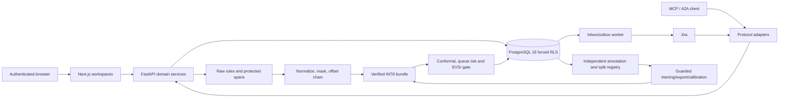

# ResolveIT architecture

Authoritative decisions and release blockers: `00_CODEX_AUDIT_AND_MASTER_PLAN.md`. Domain shapes: `../packages/resolveit-core/resolveit_core/schemas/` (link target relative to repo root is `packages/...`; do not duplicate schemas here).

## Boundaries

Core has no network/DB side effects. API verifies credentials and injects tenant context before domain reads/writes. Protocol adapters validate envelopes and reuse domain operations. Text is encrypted at rest with per-incident data keys; derived text/frame/answer copies require erasure policy too. Telemetry contains IDs, counters, safe error codes and timing only.

API uses `NullPool` and transaction-local tenant settings through transaction-mode PgBouncer. Worker advisory leadership uses direct PostgreSQL connection; durable jobs additionally require row-level leases so failover is recoverable. Production readiness includes DB/bundle availability, unlike legacy liveness-only `/healthz`.

Persist-first intake commits encrypted report/SLA and work reservation before expensive evaluation. Subsequent evaluation is idempotent and recoverable. All routing output/outbox state changes share transaction. No database transaction waits for external Jira HTTP response. Inbox deduplicates signed deliveries; outbox retries bounded transient errors with dead-letter inspection.

## Statistical isolation

Training, temperature scaling, conformal fitting, threshold selection, risk certification and frozen evaluation are explicit versioned roles. Dataset membership is immutable after freeze; grouped duplicates cannot cross boundaries. Queue certification refers to actual shipped action policy and sufficient unbiased human samples. Synthetic bundles cannot authorize real-tenant automatic routes. Hash manifest covers every artifact affecting decisions, including tokenizer, costs, theta and policy.

## Deployment

Compose supplies development boot with generated local secrets and synthetic tenants. Production requires TLS, session identity, managed KMS, secret injection, backups/restores, erasure replay, least-privilege roles, dependency scanning and measured cutover rollback. Missing infrastructure must fail gates visibly; it cannot be replaced by mocks under a production label.
